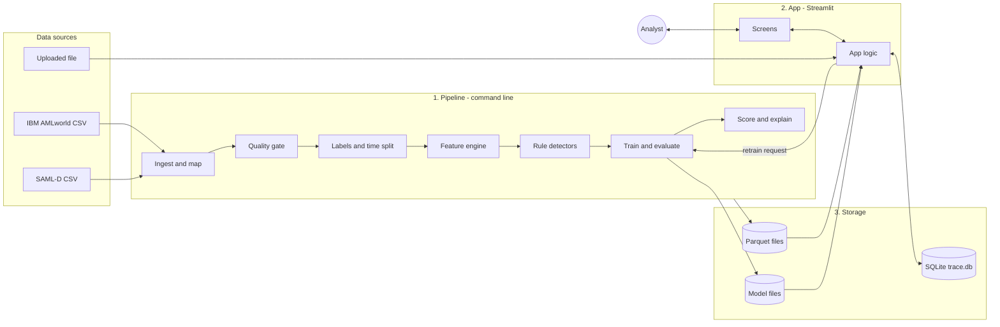

# TRACE — Architecture (System Design)

| | |
|---|---|
| Doc | 03 of the TRACE doc set |
| Purpose | How TRACE is built: the parts, how data flows between them, where everything lives, which tools are used and why, how to run it, and how the design protects against data leakage |
| Read with | `04-CONTRACT.md` for exact file formats; `05-FEATURES-MODEL.md` for what each pipeline step computes; `06-DASHBOARD.md` for the screens |
| Progress | Tracked only in `CHECKLIST.md` |

🔧 = tunable starting value. ⚠️ = must be confirmed with a quick test before relying on it.

---

## 1. The big picture

TRACE has **three parts**:

| Part | What it is | When it runs |
|---|---|---|
| **1. Pipeline** (backend, heavy) | Python scripts that load data, check it, compute features, train models, score accounts and build explanations | Before the demo, from the command line. Each step saves its output |
| **2. App** (frontend + light backend) | One Streamlit program. It draws the screens **and** does the light work: reading scores, building the graph around a clicked account, saving feedback, starting a retrain | During the demo |
| **3. Storage** | **Parquet files** for big data that does not change once made; **SQLite** (`trace.db`) for small data that changes while the app runs | Always |

With Streamlit, the screens and the light backend logic run **in the same program**. There is no separate server and no API between them. That is a deliberate trade-off: much less to learn and build. A separate API (FastAPI) is parked as P-02; section 12 shows how it would slot in without rewriting anything.



## 2. Pipeline steps

Each step is one Python module, can be run on its own, reads files, writes files, and never needs the step after it. If a step's result looks wrong, fix that step and rerun **only that step and the ones after it**.

| Step | Module | Reads | Writes | Feature |
|---|---|---|---|---|
| P1 Ingest | `pipeline/ingest.py` | `data/raw/<dataset>/` | `data/processed/<dataset>/transactions.parquet`, `labels_txn.parquet` | F-01 |
| P2 Quality gate | `pipeline/quality.py` | processed files | `reports/quality_<dataset>.md` + `.json` | F-02 |
| P3 Labels and split | `pipeline/labels.py` | processed files (+ patterns file) | `account_labels.parquet`, `splits.json` | F-03 |
| P4 Features | `pipeline/features.py` | `transactions.parquet`, a cut-off time | `data/features/<dataset>/<cutoff>.parquet` | F-04 |
| P5 Rules | `pipeline/rules.py` | `transactions.parquet`, cut-off | `data/features/<dataset>/<cutoff>_rules.parquet` (flags) and `<cutoff>_rules_evidence.parquet` (evidence) | F-05 |
| P6 Train and evaluate | `pipeline/train.py`, `pipeline/evaluate.py` | features, rules, labels, splits | `models/<version>/`, `reports/eval_<version>.md` + `.json` | F-06 |
| P7 Score and explain | `pipeline/score.py`, `pipeline/explain.py` | model, features, transactions | `data/runs/<run_id>/scores.parquet`, `reasons.parquet`, `trails.parquet` | F-07, F-08 |
| P8 Demo file | `pipeline/demo_file.py` | processed IBM + labels + the full test run | `data/demo/` (CSV) and `data/runs/demo__…/` (pre-scored slice of the test run) | F-11 |
| P9 Replay *(L2)* | `pipeline/replay.py` | everything above | `reports/replay_<version>.md` + `.json` | F-12 |
| P10 Rings *(L2)* | `pipeline/rings.py` | scores, trails, transactions | `data/runs/<run_id>/rings.parquet` | F-13 |
| P11 Explanation check *(L3)* | `pipeline/explain_check.py` | trails, labels | `reports/explain_check_<version>.md` + `.json` | F-15 |
| P12 Cross-dataset *(L3)* | `pipeline/cross_dataset.py` | IBM model, SAML-D features + labels | `reports/cross_<version>.md` + `.json` | F-16 |

**One command to run everything in order:**
```bash
python -m trace_aml.pipeline.run_all --dataset ibm_hi_small
```
Each step also runs alone, e.g. `python -m trace_aml.pipeline.features --dataset ibm_hi_small --cutoff 2022-09-07T00:00`.

**Package name:** the code package is `trace_aml`, **not** `trace`, because Python already has a built-in module called `trace` and the clash causes confusing import errors.

### 2.1 Runs
A **run** = one dataset scored by one model version. Every run gets its own folder `data/runs/<run_id>/` (e.g. `ibm_hi_small__test__v1`), containing its scores, reasons, trails, rings and a `manifest.json` (which data, which model, which cut-off, when, with what settings). The app shows one run at a time; the sidebar picks which.

### 2.2 Manifests
Every pipeline step writes a small `manifest.json` next to its output: input files (+ size and modified time), settings used, random seed, contract version, start and end time. When a number in a report looks odd, the manifest says exactly what produced it.

## 3. App (Streamlit)

| Module | Job |
|---|---|
| `app/main.py` | Entry point; sidebar; page routing |
| `app/pages/` | One file per screen (Overview, Alert queue, Account, Rings, Models, Data quality). Screen details in `06-DASHBOARD.md` |
| `app/logic/data_access.py` | Reads a run's Parquet files (cached), reads/writes SQLite |
| `app/logic/neighbourhood.py` | Builds the small graph around one account (merging repeat transfers, capping size) |
| `app/logic/upload.py` | Validates an uploaded file, then calls the pipeline's feature, score and explain functions on it |
| `app/logic/feedback.py` | Saves analyst decisions |
| `app/logic/retrain.py` *(L2)* | Builds the new training set with feedback, calls the training function, registers the new version |
| `app/components/graph.py` | Wraps the interactive graph component (section 7) |

**Rule:** the app **imports** pipeline functions; it never copies their logic. Feature code exists in exactly one place.

### 3.1 Upload path (F-09 step 1)
1. Analyst uploads a CSV in the **TRACE upload format** (`04-CONTRACT.md` section 3).
2. `upload.py` runs the contract checker. On failure: a clear message listing exactly what is wrong; nothing else happens.
3. On success: compute features (cut-off = last timestamp in the file) → score with the **active model** → explain → save as a new run `upload__<timestamp>__<version>`.
4. The app switches to that run.

The uploaded file is treated as the whole history, and **every account in the file is scored** (one cut-off, the file's whole time span counts as the activity window). Network measures on a small file differ from those on a full dataset, so accounts with little history score less reliably; the Overview screen says so.

### 3.2 Retrain path (F-14, Layer 2)
1. Admin presses **Retrain**.
2. **Which features a decision attaches to:** each feedback row names its `run_id`. The decision becomes **one new training row**: the account's features from that run (the run's cut-off; for split runs, the snapshot that produced its score), labelled **Confirmed Mule → 1**, **False Positive → 0**, **Needs Investigation → ignored**. Only the account's latest decision counts.
3. **Overrides:** if the same account already has original training rows, those rows take the feedback label too (feedback wins; it is the analyst's call).
4. **Two kinds of retrain, kept apart for honesty:**
   - **Evaluation-safe:** uses only feedback given on runs of kind `SPLIT` for the **train or validation** period. The resulting model can appear in reported metrics.
   - **Demo:** uses all feedback, including on `TEST`, `DEMO` and `UPLOAD` runs. This is what the live demo shows. The resulting version is marked `eval_valid = 0` in `model_versions`, labelled "demo only" on the Models screen, and **never** used in any reported metric.
5. Train with the same settings as the parent version.
6. Evaluate on the validation period; save as `models/v<n+1>/`; insert a row in `model_versions`.
7. The new version is **not** active until the admin switches to it on the Models screen. Switching back is always possible.
8. Retraining takes seconds to a few minutes because features are already saved; only the model fit is repeated. Runs keep their feature files so step 2 can find them (`data/runs/<run_id>/features.parquet`).

## 4. Storage

### 4.1 What goes where
| Store | Holds | Why this store |
|---|---|---|
| Parquet (`data/…`) | Transactions, labels, features, scores, reasons, trails, rings | Large, written once by the pipeline, read many times. Parquet is compact and fast with pandas |
| Model files (`models/…`) | Trained models + their metadata | One folder per version; never overwritten |
| SQLite (`trace.db`) | Feedback, model version registry, app settings (active version, active run) | Small, changes while the app runs, needs safe updates |
| Markdown + JSON (`reports/…`) | Quality reports, evaluation results | Readable by people (markdown) and by code (JSON) |

### 4.2 SQLite tables
Exact columns in `04-CONTRACT.md` section 6.
- `feedback`: one row per analyst decision (account, decision, analyst, role, time, model version, run, note).
- `model_versions`: one row per trained model (version, created, created by, training set description, validation metrics, file path).
- `app_state`: key–value pairs (`active_model_version`, `active_run_id`).

The analysts' names and roles live in `config/settings.yaml`, not the database (there is no login; PRD F-17).

### 4.3 Inspecting and editing data by hand
| Want to… | Do this |
|---|---|
| Browse or edit SQLite tables | Open `trace.db` in **DB Browser for SQLite** (free GUI), or run `sqlite3 trace.db` in a terminal and type SQL |
| Fix one feedback row | `UPDATE feedback SET decision = 'FALSE_POSITIVE' WHERE feedback_id = 12;` |
| Query a Parquet file with SQL | Optional tool DuckDB: `SELECT * FROM 'data/runs/<run_id>/scores.parquet' WHERE risk >= 70;` |
| Look at a Parquet file in Python | `pd.read_parquet(path).head()` |

**Never hand-edit Parquet outputs.** They are pipeline outputs: fix the step and rerun it. Hand-editing SQLite (feedback, app state) is fine.

## 5. Folder layout

```
trace/                          ← repo root
├── AGENTS.md                   ← working rules (read first)
├── CHECKLIST.md                ← progress tracker
├── README.md
├── requirements.txt
├── .gitignore                  ← ignores data/raw, data/processed, data/features, data/runs, models, trace.db
├── config/
│   └── settings.yaml           ← all tunable values in one place (section 6)
├── docs/                       ← this doc set (01–06)
├── data/
│   ├── raw/<dataset>/          ← downloads, never edited
│   ├── processed/<dataset>/    ← common format (P1, P3)
│   ├── features/<dataset>/     ← features + rule flags per cut-off (P4, P5)
│   ├── runs/<run_id>/          ← scores, reasons, trails, rings (P7, P10)
│   ├── demo/                   ← demo file + pre-scored run (P8)
│   └── fake/                   ← contract-shaped fake files for building the app early
├── models/v1/ v2/ …            ← trained models + meta.json
├── reports/                    ← quality, evaluation, replay, explain-check, cross-dataset
├── trace_aml/                  ← the Python package
│   ├── config.py               ← loads settings.yaml
│   ├── contract.py             ← schemas + checker (one source of truth for doc 04)
│   ├── pipeline/               ← P1–P12 + run_all.py
│   ├── features/               ← structural.py, temporal.py, flow.py, relative.py, catalog.py
│   ├── models/                 ← baselines.py, lgbm.py, calibrate.py
│   └── explain/                ← shap_reasons.py, trails.py, summary.py
├── app/                        ← Streamlit app (section 3)
├── scripts/
│   ├── check_contract.py       ← "does this folder match the contract?"
│   └── make_fake_data.py       ← writes data/fake/ for app work before the model exists
├── notebooks/                  ← exploration only; nothing the pipeline depends on
└── tests/
```

## 6. Configuration

Every tunable value lives in **one** file, `config/settings.yaml`. No magic numbers in code. Sketch:

```yaml
contract_version: 1
random_seed: 42

currency:
  base: USD
  rates_to_base: {USD: 1.0, EUR: 1.08, ...}   # 🔧 fixed rates, filled in on first load
  display: INR
  display_rate_per_base: 96.0                 # 🔧 set to current rate when created

split: {train: 0.6, validation: 0.2, test: 0.2}   # 🔧

features:
  windows_hours: [1, 6, 24]                   # 🔧
  pass_through_delta_hours: [1, 24]           # 🔧
  betweenness: {enabled: true, cutoff_hops: 3}   # 🔧 dropped if too slow
  snapshot_every_hours: 24                    # 🔧

rules: { ... }                                # thresholds, see doc 05
model: { ... }                                # LightGBM settings, see doc 05
verdicts: {likely_mule_min_precision: 0.5, watch_min_recall: 0.8}   # 🔧

graph_view: {max_nodes: 40, default_hops: 1}  # 🔧

demo_channel_relabel: {Wire: IMPS, ACH: NEFT, "Credit Card": UPI, ...}   # 🔧 cosmetic

analysts:
  - {name: "Analyst A", role: analyst}
  - {name: "Analyst B", role: analyst}
  - {name: "Admin", role: admin}
```

## 7. Tech stack

| Tool | Used for | Why this and not something else |
|---|---|---|
| Python 3.11 | Everything | One language for data, ML and UI |
| pandas 2 + pyarrow | Tables, Parquet files | Standard; fast enough for 5M rows with explicit types |
| NetworkX 3 | Graph building and simple measures; the per-account neighbourhood in the app | Easiest graph library to learn |
| python-igraph | Heavy graph measures on the full graph (PageRank, community detection, limited betweenness) | Written in C, many times faster than NetworkX on 500K accounts |
| LightGBM 4 | Main model | Fast on CPU, strong on tables, handles imbalance, works directly with SHAP |
| scikit-learn | Logistic Regression, Random Forest, Isolation Forest baselines; calibration; metrics | Standard ML toolkit |
| SHAP | Per-account reasons | Exact and fast for tree models (TreeExplainer) |
| Optuna *(optional)* | Tuning LightGBM settings | Only after the defaults work |
| Streamlit | The app | Pure Python UI; no JavaScript |
| Graph component | Interactive network view | ⚠️ Candidate: `streamlit-agraph` (returns the clicked node, needed for "hop"). Confirm with a 30-minute test first. Fallback: `pyvis` drawing + a search box to pick the account (PRD F-09 allows this) |
| SQLite | Feedback, versions, app state | One file, built into Python, nothing to install |
| PyYAML | Reading settings | |
| pytest | Tests | |
| DuckDB *(optional)* | SQL over Parquet for inspection | Not used by the pipeline |

No GPU, no paid service, no language model anywhere in the system.

## 8. Performance plan (16 GB laptop)

| Risk | Plan |
|---|---|
| 5M rows use too much memory | Explicit column types (categories for IDs and channels, float32 amounts); load only needed columns; process by time slice if needed |
| Betweenness too slow on 500K accounts | igraph with a 3-hop limit 🔧; if still too slow, drop it (the ablation shows whether it mattered) |
| Recomputing features for every experiment | Features saved per cut-off; experiments only reread them |
| Replay (F-12) recomputes features many times | Re-score only accounts active in the last 24 h; refresh heavy graph measures every 6 h of data, fast features every step 🔧 |
| App feels slow | Cache run files in memory (`st.cache_data`); build neighbourhoods from a pre-indexed transactions table; target: account + graph open in ≤ 3 s |
| Laptop still struggles | Run the heavy pipeline steps on Google Colab (free) and copy the output files back |

## 9. Leakage guards (built into the design)

1. **Labels live in separate files.** Feature code never opens them; a test checks that the feature modules do not import or read label files.
2. **Every feature function takes a `cutoff` argument and is required to use it.** A test plants a fake transaction one second after the cut-off with an extreme amount and checks that no feature changes.
3. **The test period is only read by `evaluate.py`**, and only for final numbers.
4. **Feedback on test, demo or upload runs never reaches an evaluation model.** It may only produce "demo only" versions (section 3.2).
5. **The demo file comes from the test period** and is never used for training.

## 10. Testing

| Test | Checks |
|---|---|
| Mapping | IBM and SAML-D samples map to the common format correctly (hand-made 10-row samples) |
| Labelling | Hand-made mini graph: mule / source / sink / normal come out right |
| Leakage | Section 9 items 1 and 2 |
| Features | Hand-made mini graphs with known answers (e.g. a pure pass-through account has pass-through ratio 1.0) |
| Rules | Each rule fires on its pattern and not on a normal account |
| Contract | `scripts/check_contract.py` passes on fake data and on real outputs |
| App smoke test | App starts and opens one account on the fake data |

## 11. Building in parallel (team split)

Default split (PRD Q1, team may change it):
- **Person A (data + ML):** P1–P8, then P9–P12.
- **Person B (app):** builds every screen against `data/fake/` (made by `scripts/make_fake_data.py` in the exact contract format) **before the real model exists**.

How it stays safe:
1. `04-CONTRACT.md` and `trace_aml/contract.py` are the single agreement. Neither person changes a file format without updating both and bumping `contract_version`.
2. Both run `scripts/check_contract.py` on their files.
3. **First integration happens as soon as P7 produces one real run**, not at the end: point the app at `data/runs/<real_run>/` instead of `data/fake/`.
4. Swap roles in Layer 2 so both know both halves for the viva.

## 12. Parked: separate API (P-02)

If TRACE later needs a classic separate backend (for the resume, or a non-Streamlit frontend):
- Add `api/` with FastAPI endpoints that call the **same** `app/logic/` functions: `GET /alerts`, `GET /accounts/{id}`, `GET /accounts/{id}/neighbourhood`, `POST /feedback`, `POST /retrain`, `POST /upload`.
- The Streamlit app switches from calling `app/logic/` directly to calling the API.
- Wrap both in Docker Compose.
Nothing in the pipeline or storage changes. That is why `app/logic/` is kept separate from `app/pages/` from day one.

## 13. Decisions

| Decision | Reason |
|---|---|
| Streamlit app holds both UI and light logic | Least to learn; evaluator sees no difference |
| `app/logic` kept separate from `app/pages` | Lets P-02 (FastAPI) be added later without rewrites |
| Parquet + SQLite split | Big unchanging data vs small changing data |
| igraph for heavy measures, NetworkX for small ones | Speed where it matters, simplicity elsewhere |
| Package name `trace_aml` | Avoids clash with Python's built-in `trace` module |
| One settings file | Every 🔧 value is findable and changeable in one place |
| Runs as folders with manifests | Any number can be traced back to exactly what produced it |
